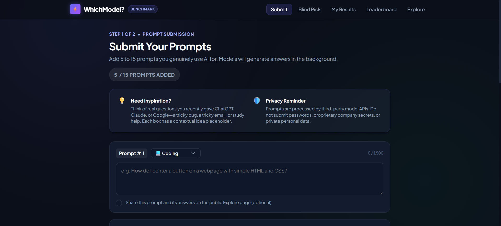
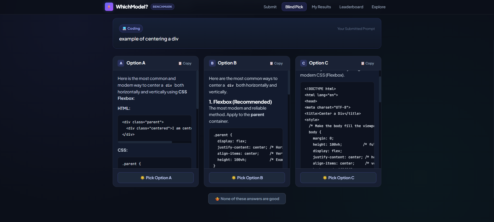
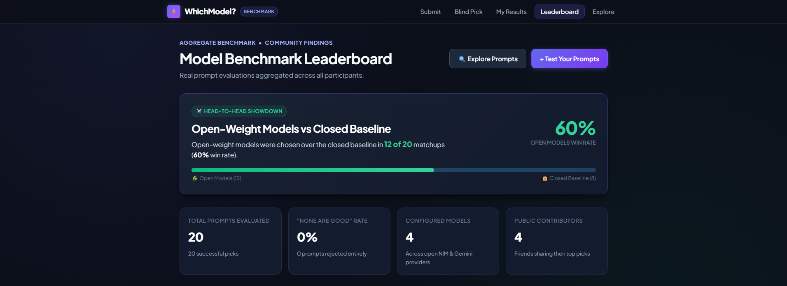

# WhichModel?

## Ask your friends. Let the models compete. Find your best AI.

**WhichModel?** is a small, invite-only benchmark for answering a very practical question:

> **Which AI model works best for the things I actually do?**

Instead of trusting generic leaderboards, people submit their own prompts, compare anonymous answers from several models, and vote for the answer they like best. The app then turns those votes into personal insights and a shared leaderboard.

It is built for friends, classmates, teammates, and anyone who wants a useful answer instead of another hype-filled model ranking.

## The idea in one minute

1. Enter an invite code.
2. Add 5–15 prompts you really use for coding, writing, studying, summaries, translation, or anything else.
3. Wait while the models answer in the background.
4. Compare anonymous answers labelled **A**, **B**, **C**, and **D**.
5. Pick the best answer — or say **None are good**.
6. See which models are strongest for you and how the group voted.

Model names stay hidden until after each vote, so brand loyalty does not get to choose the winner.

## See it in action

### 1. Add your real prompts

Tell WhichModel? what you actually ask AI, rather than testing it with one carefully chosen demo question.



### 2. Choose the answer you prefer

The same prompt is sent to multiple models. Their answers are shuffled and shown without model names.



### 3. Check the leaderboard

Once enough people have voted, the results show which models perform best overall and by task category.



## What happens behind the scenes?

- **Invite-only access:** People join with an invite code and a signed session cookie — no password system to manage.
- **Background generation:** The app asks the configured models for answers in the background, with retries and provider limits.
- **Blind comparison:** Answer order is randomized and model names are hidden until voting is finished.
- **Useful results:** Personal results show your strongest models; the group leaderboard shows broader trends.
- **Privacy controls:** Participants can delete their prompts, answers, and voting history.

## Models

Models are configured in [`config/models.yaml`](config/models.yaml), so changing the benchmark does not require changing application code.

| Model | Type | Provider | Role |
|---|---|---|---|
| Llama 3.2 11B Vision Instruct | Open-weight | NVIDIA NIM | Open candidate |
| Qwen 3.8 27B | Open-weight | Groq | Open candidate |
| GPT OSS 20B | Open-source, Apache 2.0 | Groq | Open candidate |
| Gemini 3.5 Flash Lite | Closed | Google Gemini API | Comparison baseline |

The closed model is included as a baseline, not as the point of the project. The goal is to make open models easier to compare on tasks that matter to real people.

## Run it locally

### Requirements

- Python 3.11+
- API keys for the models you want to enable

### Setup

```powershell
py -3.11 -m venv .venv
.\.venv\Scripts\Activate.ps1
pip install -r requirements.txt
Copy-Item .env.example .env
```

Add your local settings and API keys to `.env`:

```env
DATABASE_URL=sqlite:///./whichmodel.db
SESSION_SECRET=local-dev-secret-key-change-me
INVITE_CODES=testcode
DAILY_CALL_CAP=100
GENERATION_ENABLED=true
GEMINI_API_KEY=your_gemini_key
GROQ_API_KEY=your_groq_key
NVIDIA_API_KEY=your_nvidia_key
```

Run the tests:

```powershell
pytest
```

Start the app:

```powershell
uvicorn app.main:app --reload --host 127.0.0.1 --port 8000
```

Open <http://localhost:8000>.

Optional model smoke test:

```powershell
python scripts/smoke_test_models.py
```

## Deploy it on Render

The repository includes a [`render.yaml`](render.yaml) Blueprint for a FastAPI web service and a managed PostgreSQL database.

1. Push the repository to GitHub.
2. In Render, choose **New → Blueprint**.
3. Connect the repository.
4. Add `INVITE_CODES`, `GEMINI_API_KEY`, `GROQ_API_KEY`, and `NVIDIA_API_KEY`.
5. Apply the Blueprint.

The app uses an in-process background worker, so deploy a single web service instance. Render's free tier may sleep when idle, and its free PostgreSQL databases are temporary — export important results if you need to keep them.

## Privacy and fairness

- Prompts are sent to the third-party model providers configured for the benchmark.
- Do not submit passwords, private documents, or sensitive personal information.
- The same system prompt, temperature, and token limit are used for every model.
- Model names are hidden before a vote.
- Failed model calls are excluded rather than shown as bad answers.
- Participants can delete their data from the personal results page.

## Important limitations

This is a friend-powered benchmark, not a scientific evaluation. Results can be affected by:

- a small or uneven number of votes;
- the kinds of prompts this particular group submits;
- answer length and writing style;
- one answer per prompt and model;
- one closed baseline from one provider;
- free-tier API limits and occasional provider failures.

Treat the leaderboard as a helpful signal, not an eternal ranking carved into stone.

## Project status

| Phase | Status |
|---|---|
| Foundation, providers, and CI | Complete |
| Prompt queue and blind choosing | Complete |
| Results, privacy, and deployment | Complete |
| Live testing and write-up | In progress |

## License

The application code is available under the MIT License. The models are subject to their own licenses and provider terms; see the model notes in [`config/models.yaml`](config/models.yaml).
