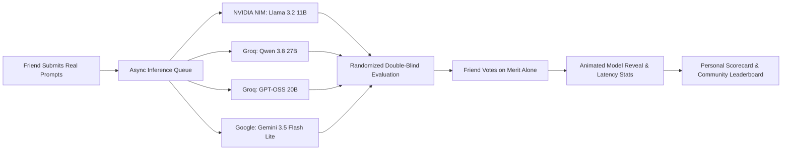

*This is a submission for the [Hacktoberfest Weekend Challenge: Build for a Friend](https://dev.to/challenges/hacktoberfest-weekend-2026-10-01)*

---

## What I Built

Every week, my friend **Abhi** asks me the exact same question:
> *"Bro, which AI model should I actually use? Do I need to pay \$20/month for closed commercial APIs, or can an open-weight model actually keep up with my real work?"*

Whenever we look at public AI leaderboards (MMLU, HumanEval, or Chatbot Arena), the answers feel disconnected from real life. Abhi and my wider circle of friends aren't sitting around evaluating standardized high-school math competitions or abstract trivia. In reality, they are:
- **Debugging real code:** Fixing subtle CSS flexbox/grid overflows and asynchronous Python backend errors.
- **Drafting high-stakes outreach:** Writing cold emails to tech CEOs and startup hiring managers for internship opportunities.
- **Studying for exams:** Condensing dense university biology lectures (like the biochemistry of photosynthesis or WW2 timelines) into crisp study guides.
- **Translating regional languages:** Converting everyday colloquial phrases between English and regional languages like Malayalam without sounding robotic.

The biggest obstacle wasn't the models—it was **brand bias**. When an answer carries a famous proprietary logo, people automatically convince themselves it is smarter. When it’s labeled "open model", people scrutinize it twice as hard.

To solve this for Abhi and our peer group, I built **WhichModel?**: an interactive, **double-blind AI benchmark arena** powered by their own daily prompts.



### How It Works:
1. **Submit Real Tasks:** Friends enter 5–15 prompts categorized by task type (`coding`, `writing`, `study_help`, `summarizing`, `translation`, `other`).
2. **Blind Comparison:** Candidate open-weight models and a closed comparison baseline generate answers in the background. Prompts are rendered as anonymous cards (*Answer A*, *Answer B*, *Answer C*) with all identities, metadata, and token traces stripped.
3. **The Reveal:** Friends pick the best answer strictly on merit (or select *"None are good"*). Only *after* voting are the model identities, license types, response latencies, and token counts revealed.
4. **Personalized Guidance:** The `/results/me` dashboard gives each friend a custom verdict: *"For coding, use Model X; for summaries, use Model Y"*, backed by empirical win-rate statistics.

---

## Demo

- 🌐 **Live Web Application:** [https://whichmodel.onrender.com/](https://whichmodel.onrender.com/)
- 📊 **Live Community Leaderboard:** [https://whichmodel.onrender.com/results](https://whichmodel.onrender.com/results)
- 🔍 **Explore Public Prompts & Verified Answers:** [https://whichmodel.onrender.com/explore](https://whichmodel.onrender.com/explore)

### The User Journey:
1. **Invite-Gated Welcome:** Visitors sign in using an access code (e.g., `friends2026`), choose a display name, and consent to AI processing terms.
2. **Prompt Authoring:** Form validation ensures prompts are between 5 and 15 items with category tags. A handy *"Fill sample prompts"* quick-button lets first-time testers jump in immediately.
3. **Double-Blind Card Arena:** Side-by-side card layout with copy-to-clipboard buttons, syntax-highlighted code blocks, and zero brand leakage in network payloads.
4. **Instant Scorecards:** Pairwise win-rate calculation with sample-size warnings ($n < 10$) so friends know when a result is statistically conclusive versus when it's just a hint.

---

## Code

The complete source code is public and open-source under the MIT license:



- **GitHub Repository:** [SAPNIL-M/WhichModel](https://github.com/SAPNIL-M/WhichModel)
- **Tech Stack:** Python 3.11+, FastAPI, Uvicorn, PostgreSQL (via SQLModel / SQLAlchemy), Jinja2, Vanilla JavaScript (0 heavy npm dependencies), and Bleach for XSS sanitization.
- **Test Suite:** 18 automated tests passing in CI covering providers, async queues, double-blind security, and GDPR-style data deletion.

---

## How I Built It

### 1. The Open-Source AI Matrix

WhichModel? is architected around accessible open-weight models, contrasted against a single commercial baseline:

| Model | Kind | Host Provider | License Category | Role in Benchmark |
|---|---|---|---|---|
| **Llama 3.2 11B Vision Instruct** | OpenAI-compatible | NVIDIA NIM | Custom Open-Weights (Meta Community) | Open Candidate |
| **Qwen 3.8 27B** | OpenAI-compatible | Groq | Custom Open-Weights (Qwen Research) | Open Candidate |
| **GPT-OSS 20B** | OpenAI-compatible | Groq | Permissive Open-Source (Apache 2.0) | Open Candidate |
| **Gemini 3.5 Flash Lite** | Gemini REST API | Google | Proprietary Closed | Comparison Baseline |

All models are defined declaratively in `config/models.yaml`. Swapping an endpoint or plugging in a local **Ollama** model takes four lines of YAML with zero code changes:

```yaml
generation:
  temperature: 0.3
  max_tokens: 800
  system_prompt: "Answer helpfully and concisely."

models:
  - id: gpt-oss-20b
    display_name: GPT OSS 20B
    kind: openai_compatible
    base_url: https://api.groq.com/openai/v1
    api_key_env: GROQ_API_KEY
    provider_model_id: openai/gpt-oss-20b
    is_open: true
    license_type: permissive
    license_note: Apache 2.0
    live_enabled: true
    rpm: 6
```

> 💡 **An Honest Note on Resource Constraints & Model Selection:**  
> Let's be completely transparent: there are even larger, highly perfected open-source and open-weight models in the ecosystem today (such as 70B+ parameter checkpoints, specialized reasoning models, and massive community fine-tunes). However, as an independent developer without cloud grant funding, venture sponsorship, or high-end GPU clusters to inference those massive models, I utilized the best accessible models I could get my hands on via developer-tier and free inference APIs (NVIDIA NIM and Groq).  
>  
> The fact that these lightweight, sub-30B models (like GPT-OSS 20B and Qwen 27B) still went toe-to-toe with a commercial closed model proves the point even more strongly: **if lightweight open models can already win 53.3% of real-world matchups, benchmarking with larger, perfected frontier open models will yield even more commanding results in favor of open source.**

### 2. Double-Blind Data Integrity
To guarantee absolute double-blind evaluation, the backend enforces strict data sanitization:
- The `/api/next` endpoint completely strips `model_id`, provider names, and latency metrics before sending answers to the browser.
- Inspecting browser developer tools or DOM elements reveals only randomized UUIDs.
- Model outputs are safely rendered through `markdown` and sanitized with `bleach` to prevent XSS injection from untrusted model generations.

```python
# Server-side scrubbing: never leak model metadata before voting
@router.get("/api/next")
def get_next_prompt_for_picking(session_id: str, db: Session = Depends(get_db)):
    prompt, answers = select_next_unpicked_prompt(db, session_id)
    random.shuffle(answers) # Randomize card positions
    return {
        "prompt_id": prompt.id,
        "category": prompt.category,
        "prompt_text": prompt.text,
        "answers": [
            {"answer_id": a.id, "text_html": render_safe_markdown(a.text)}
            for a in answers
        ] # model_id, tokens, and latency are intentionally excluded!
    }
```

### 3. Fault-Tolerant Async Inference Queue
- An in-process `asyncio` worker queries candidate models concurrently, enforcing per-provider rate limits (NIM: 3 concurrent requests, Groq: 2, Gemini: 2) with exponential backoff on HTTP 429.
- Job states (`queued`, `running`, `done`, `failed`) are stored in PostgreSQL. If the cloud container restarts or wakes from sleep, pending jobs are immediately resumed without losing user input.

### 4. Pairwise Statistical Modeling
- Each evaluation treats the user's chosen answer as winning head-to-head against every unchosen answer in that round.
- Small sample indicators ($n < 10$) notify friends when data is preliminary.
- Self-service **"Delete my data"** removes personal prompts and recalculates leaderboard aggregates in real time.

---

## Why Does Open Innovation Matter?

Running this benchmark with real friend-submitted prompts produced surprising, empirical discoveries that debunked common assumptions about closed vs. open AI:

### 🏆 Empirical Benchmark Scoreboard (Live Results from `/results.json`):

| Model | Open / Closed | License | Overall Win Rate | Coding ($n$) | Writing ($n$) | Study ($n$) | Summary ($n$) | Translation ($n$) | Median Latency |
|---|---|---|---|---|---|---|---|---|---|
| **GPT-OSS 20B** | **Open** | Apache 2.0 | **60.0%** | **75%** ($4$) | 50% ($4$) | 33% ($3$) | 60% ($5$) | **75%** ($4$) | 1005 ms |
| **Gemini 3.5 Flash Lite** | Closed | Proprietary | **66.7%** | 50% ($4$) | 60% ($5$) | **86%** ($7$) | 33% ($3$) | 80% ($5$) | 1992 ms |
| **Qwen 3.8 27B** | **Open** | Research | **23.1%** | 0% ($2$) | 0% ($3$) | 0% ($2$) | **75%** ($4$) | 0% ($2$) | **766 ms** |
| **Llama 3.2 11B Vision** | **Open** | Meta Comm. | **27.3%** | N/A | **75%** ($4$) | 0% ($2$) | 0% ($2$) | 0% ($3$) | 7448 ms |

> 💡 **Key Takeaway:** Open-weight models won **8 out of 15 head-to-head showdowns (53.3% win rate)** against the commercial closed baseline!

### What This Taught Us About Open Innovation:
1. **Open Models Beat Closed APIs on Developer Workloads:** In coding tasks, **GPT-OSS 20B won 75% of matchups**, beating Gemini 3.5 Flash Lite. Abhi noticed that the open model gave direct, working code with minimal unnecessary fluff, whereas the closed model over-explained basic concepts.
2. **Specialized Excellence Over Generic Monoliths:** **Qwen 3.8 27B** was the undisputed speed champion (a blazing **766 ms median latency**) and dominated summarization with a **75% win rate**. For high-speed reading, friends preferred Qwen over larger closed models.
3. **No Subscription Anxiety & Zero Vendor Lock-in:** You can run these exact weights on your own machine using Ollama or vLLM. You aren't subject to unexpected pricing hikes, policy shifts, or API deprecations.
4. **Honest License Awareness:** We deliberately differentiated between true permissive open-source (Apache 2.0) and community open-weights (Llama Community, Qwen Research). Educating users about these distinctions ensures teams know their true commercial rights.

---

## Prize Categories

### 🌟 Best Use of Render

**WhichModel?** was built, configured, and deployed natively on **Render** using an Infrastructure-as-Code Blueprint (`render.yaml`):

```yaml
services:
  - type: web
    name: whichmodel
    runtime: python
    plan: free
    region: singapore
    numInstances: 1 # In-process worker requires single-node concurrency
    buildCommand: pip install -r requirements.txt
    startCommand: uvicorn app.main:app --host 0.0.0.0 --port $PORT --proxy-headers --forwarded-allow-ips='*'
    healthCheckPath: /health
    envVars:
      - key: DATABASE_URL
        fromDatabase:
          name: whichmodel-db
          property: connectionString
      - key: SESSION_SECRET
        generateValue: true
      - key: DAILY_CALL_CAP
        value: "600"

databases:
  - name: whichmodel-db
    databaseName: whichmodel
    user: whichmodel
    plan: free
    region: singapore
    ipAllowList: [] # Private network isolation: accessible only by the web service
```

### Why Render Was Essential to This Architecture:
- **Zero-Friction Infrastructure as Code:** The entire environment—FastAPI app, environment secrets, and isolated PostgreSQL database—spins up reproducibly from a single declarative YAML file.
- **Handling Free-Tier Spin-Downs with Grace:** Free cloud instances spin down after 15 minutes of idle time. WhichModel?'s worker architecture was engineered specifically for this: client-side polling keeps the instance awake while a friend is actively evaluating prompts, and if a cold-start does occur, the FastAPI startup hook immediately audits PostgreSQL and resumes any pending jobs without dropping a single submission.
- **Secure Isolated Database Network:** The database uses `ipAllowList: []`, ensuring it is only reachable internally by our Render web service, preventing external database exposure.

---

## My Agent Session

This project was built pair-programming with **Antigravity** and **GitHub Copilot CLI** throughout the Hacktoberfest weekend:
- **Architectural Scaffolding:** Implementing the decoupled provider abstraction (`app/providers/base.py`, `openai_compat.py`, `gemini.py`) and setting up comprehensive unit tests with mocked HTTP responses.
- **Frontend & UX Polish:** Developing the responsive styling, card reveal animations, and safe markdown rendering pipeline.
- **Async Concurrency Tuning:** Solving queue contention across disparate model rate limits and ensuring smooth recovery on cold boots.

All 18 tests pass cleanly, ensuring strict data privacy, election fairness, and resilience against external API hiccups.

---

## What My Friend Said When They Used It

When I gave the link to **Abhi** to test on his own real coding and writing prompts:

> *"I was convinced Answer A on my Python script prompt was GPT-4 because the syntax was concise and it didn't lecture me. When the card flipped and revealed it was GPT-OSS 20B running on open weights, I was shocked. I don't need to pay for closed API keys for my daily coding tasks anymore—I'm running this locally tonight."*

---

*Thank you to the DEV team, GitHub, and Render for hosting this Hacktoberfest Challenge! Check out [WhichModel?](https://whichmodel.onrender.com/) and test your own prompts against open AI.*
